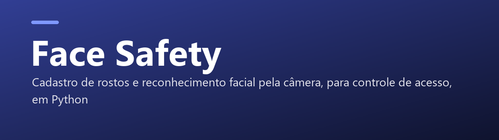
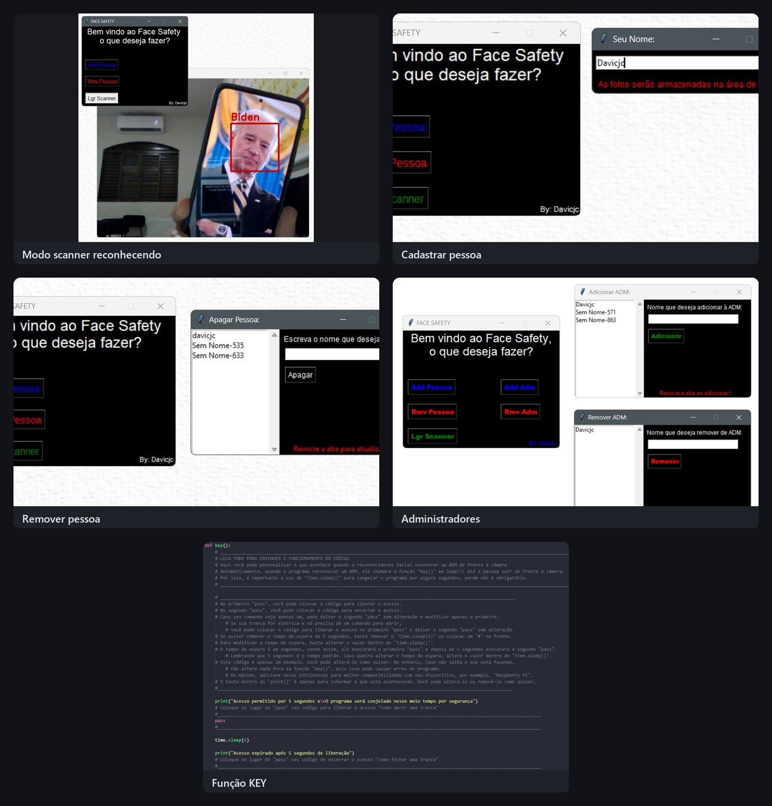

<p align="center">
  
</p>

<p align="center">
  
  
  
</p>

<p align="center">
  <b>Face Safety</b>: real-time facial recognition and access control system in Python (Windows, Linux, macOS, and Raspberry Pi).
</p>

<p align="center">
  <a href="README.md">🇧🇷 Versão em Português</a> ·
  <a href="#-one-click-execution-windows-exe">🪄 Download .EXE (1-Click)</a> ·
  <a href="#-running-from-source-v30">⚡ Run with Python</a> ·
  <a href="#️-the-key-function-access-control">🗝️ KEY Function</a>
</p>

---

# 🏛️ Project History: The Legacy vs. Next Generation

**Face Safety** started during my college days as my **first serious Python project**, written **100% by hand before the AI era** through extensive research, documentation study, and experimentation.

Over the years, the original dependencies (`dlib` and `face_recognition`) became cumbersome to install on modern systems because they require heavy C++ compilers (Visual Studio Build Tools and CMake).

To **keep the legacy alive** while preserving its history, the repository is now organized into two folders:

| Folder | Description |
| :--- | :--- |
| 🚀 **[`v3.0/`](v3.0/)** *(Recommended)* | **Modern Version (3.0):** Rebuilt using modern methods with OpenCV's built-in Deep Learning engine (**YuNet + SFace ONNX**). Requires zero C++ compilers (`dlib`, `CMake`, or `Visual Studio`). Features a modern all-in-one Dark UI and a standalone **`.exe`**! |
| 🏛️ **[`v2.5-legado/`](v2.5-legado/)** | **Classic College Version (2.5):** The original handmade code (`FaceSafety-2.5-Win.py` and `FaceSafety-2.5-Linx.py`), preserved as a historical record. |

---

# 🪄 Running on Windows (3 Optional Ways!)

### Option A: Automated Launcher (`.bat`) — *Easiest!*
Double-click **[`Iniciar-FaceSafety.bat`](Iniciar-FaceSafety.bat)** in the project root. An interactive menu lets you choose:
- **`[1]`** Launch the pre-built **`.EXE`** directly (no Python needed).
- **`[2]`** Automatically check/install `opencv-python` and run the **`.py`** source code (ideal if you customized the `key()` function).
- **`[3]`** Automatically create a clean virtual environment (`venv`) with `--no-cache-dir`, install dependencies, and launch the app.
- **`[4]`** Open `v3.0/facesafety.py` in Notepad to edit the `key()` function.

### Option B: Direct One-Click Executable (`.exe`)
1. Open the [`v3.0/`](v3.0/) folder and run **[`FaceSafety-v3.0.exe`](v3.0/FaceSafety-v3.0.exe)**.
2. On the first run, it automatically creates a `dados/` folder next to the executable and downloads the lightweight OpenCV face recognition models.

> ⚠️ **Note:** The pre-compiled `.exe` does not allow editing the `key()` function directly. If you want to customize `key()` for hardware/automation, use Option A (`[2]`/`[3]`) or Option C below!

---

# ⚡ Option C: Running from Source in Terminal (Windows, Linux, macOS, Raspberry Pi)

With **Python 3.9+** installed, run:

```bash
cd v3.0
pip install -r requirements.txt
python facesafety.py
```

---

# 🔬 How to Use Face Safety 3.0

1. **➕ Register a Person:**
   - Enter the person's name on the right panel.
   - *(Optional)* Check **"Cadastrar como Administrador"** if they should trigger the `key()` function.
   - Click **📸 Capturar da Câmera** to take a live photo, or **📁 Foto...** to import an image from disk.
2. **👥 Manage People & Admins (`ADM`):**
   - Select any person in the list and click **⭐ + / - ADM** to toggle Administrator privileges, or **🗑️ Remover** to delete their registration.
3. **▶ Start Scanner:**
   - Click **▶ Ligar Câmera / Scanner** to monitor faces in real time:
     - 🟨 **Gold Box `[ADM]`**: Recognized Administrator (triggers `key()`).
     - 🟩 **Green Box**: Recognized registered person.
     - 🟥 **Red Box**: Unregistered face (`Nao Cadastrado`).

---

# 🗝️ The `key()` Function (Access Control)

At the bottom of [`v3.0/facesafety.py`](v3.0/facesafety.py), you can customize `def key(nome: str = ""):` to unlock electronic doors, trigger relays on a Raspberry Pi, send Serial commands to an Arduino, or call a Webhook whenever an Administrator stands in front of the camera.

---

# 📸 Classic Version Screenshots (v2.5 Legacy)

<p align="center">
  
</p>

---

# 📬 Contact & Support

- 🐛 **GitHub Issues:** [Open an Issue](https://github.com/Davicjc/Face-Safety/issues)
- 📧 **Email:** `contato@davicjc.com` / `davicjc@gmail.com`
- 💬 **Telegram:** [@Davicjc](https://t.me/Davicjc)

---

<p align="center">Made by <a href="https://github.com/Davicjc">Davi Castro</a> · <a href="https://davicjc.com">davicjc.com</a></p>
